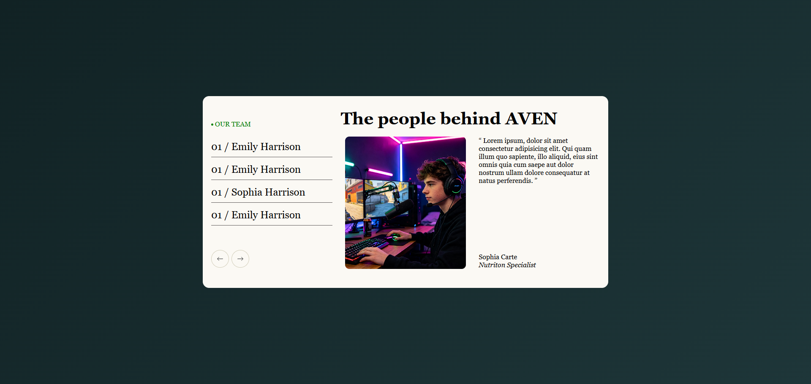

# AVEN Team Section

🔗 **[View the Live Demo Here](https://tahasoumbate.github.io/AVEN-Team-Section/)**

## 📸 Preview

A clean, responsive team showcase section designed to highlight team members and their quotes. 

## 🚀 Features
- **3-Column Layout:** Uses CSS Grid to perfectly align the header with the columns below.
- **Interactive List:** Features hover states and an "active" state to indicate the currently selected team member.
- **Custom Navigation:** Includes styled SVG arrow buttons for previous/next navigation.

## 🛠️ Technologies Used
- HTML5 (Semantic tags: `<article>`, `<figure>`, `<blockquote>`)
- CSS3 (CSS Grid, Flexbox, Transitions)

## 🧠 What I Learned
- How to align a header with a grid layout using `grid-template-columns`.
- The importance of using semantic HTML (like `<figure>` for quotes) for accessibility.
- How to create custom hover effects using background gradients.

## 📂 How to View
Simply open the `index.html` file in your browser.